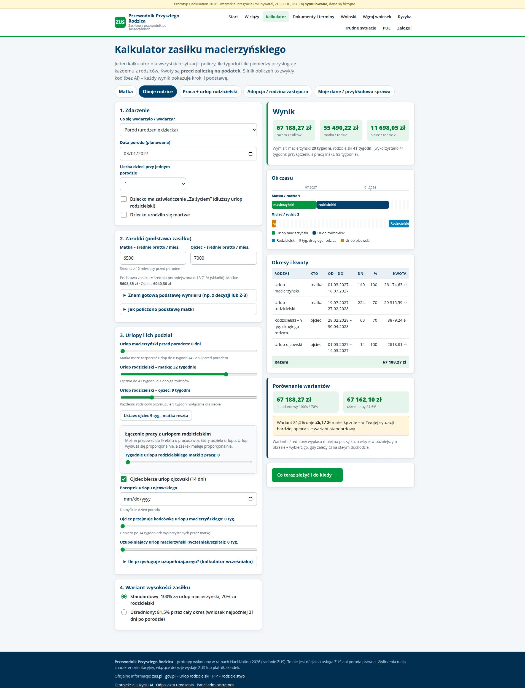

# Przewodnik Przyszłego Rodzica

Aplikacja webowa z zadania **ZUS – „Zasiłkowy Przewodnik Przyszłego Rodzica”** (HackNation 2026).
Demo: **https://zxcvbnms.dev**

Prowadzi przyszłych rodziców przez zasiłki i urlopy związane z ciążą i rodzicielstwem: co przysługuje, ile, na jak długo,
gdzie złożyć dokumenty i czego uważać. Silnik obliczeń to deterministyczny kod (bez AI); AI służy wyłącznie do odczytu skanów wniosków.



## Co jest w środku (wymagania zadania a–j)

| Wymóg | Gdzie |
|---|---|
| a) świadczenia w ciąży (chorobowe, rehabilitacyjne, w wysokości macierzyńskiego, brak uprawnień) | `/ciaza` |
| b–e, j) kalkulator: matka, ojciec, oboje, łączenie z pracą, adopcja i rodzina zastępcza | `/kalkulator` (5 trybów, oś czasu, porównanie wariantów 100/70 vs 81,5%) |
| f) indywidualna podstawa wymiaru z dokumentów | `/wgraj` (parser AI → walidacja → silnik) |
| g) dokumenty, terminy, kto wypłaca (płatnik >20 os. vs ZUS) | `/dokumenty`, `/wnioski` |
| h) ryzyka, ochrona przed zwolnieniem, trudne sytuacje | `/ryzyka`, `/trudne` |
| i) organizacje wsparcia (wyłącznie charytatywne) | `/trudne` |
| Symulacje: mObywatel, dane ZUS, e-ZLA, zadłużenie składkowe, PUE/eZUS, odpis aktu, wnioski | `/logowanie`, `/pue`, `/odpis`, `/api/zus/*`, `/api/wniosek/*` |
| Panel admina (zmiana parametrów bez programisty) | `/admin` → edytuje `data/parametry.json` |
| Responsywność (RWD) | mobile-first CSS, menu na małych ekranach |

## Architektura

```
Next.js 16 (App Router, TypeScript)  ──  /src/app/*          strony (React)
                                      └─  /src/app/api/*      REST API (route handlers, TypeScript)
src/engine/kalkulator.ts   czysty silnik obliczeń (zero zależności), 76 testów (test/testy.ts)
data/parametry.json        WSZYSTKIE liczby z przepisów (stawki, wymiary, limity, terminy) – edytowane w /admin
data/personas, scenariusze dane testowe (fikcyjne) i symulowane „API ZUS”
src/lib/parser.ts          odczyt skanów: pdftoppm → klasyfikacja stron (AI) → ekstrakcja pól (AI) → walidacja (kod)
proxy/llm-proxy.mjs        proxy do DeepInfra z limitem 100 zapytań / 1 mln tokenów
```

**Zasada:** model AI nigdy nie liczy kwot. Odczytuje pola z dokumentu do schematu JSON, a podstawę wymiaru i zasiłek liczy `kalkulator.ts`.

## Uruchomienie

```bash
npm install
npm test            # 76 testów silnika
npm run dev         # http://localhost:3100
```
Parser wymaga `pdftoppm` (pakiet `poppler-utils`). Zmienne środowiskowe: `.env.example`.

## Wdrożenie

`scripts/deploy.sh` buduje `standalone`, wysyła na serwer (SSH `srv`) i restartuje usługi systemd z `deploy/`.
Caddy kieruje `/llm/*` do proxy, resztę do aplikacji. Parametry zmienione w panelu admina nie są nadpisywane przy kolejnych wdrożeniach.

## Proxy LLM i limity

Model: **DeepSeek V4.1 Flash** (DeepInfra). Aplikacja zawsze łączy się przez własne proxy (`proxy/llm-proxy.mjs`),
a prawdziwy klucz DeepInfra jest wyłącznie w środowisku serwera. W repozytorium jest tylko **publiczny** token proxy.
Limity są twarde i łączne: **100 zapytań i 1 000 000 tokenów** (plus 20 zapytań/min na IP, allowlista modelu, sufit `max_tokens`).
Stan: `GET /llm/v1/usage`. Reset: usunięcie pliku stanu na serwerze.

## Dane i prawa

Dokumenty i przykładowe sprawy ZUS są przeznaczone wyłącznie na użytek HackNation i **nie są częścią tego repozytorium**.
Dokumenty demo (`public/demo`) są syntetyczne, z fikcyjnymi danymi (generator: `scripts/generuj_demo.py`).
Wyliczenia są orientacyjne – przed zaliczką na podatek; nie zastępują decyzji ZUS.

## Strona główna i ścieżki spraw (UX)

Główna zasada: **jedna sprawa = jedna ścieżka, jedno pytanie na ekran, na końcu ściąga „co wpisać w którym polu”.**

- `/` – „Co chcesz załatwić?”: moment życia (3 wybory) → 3 najczęstsze sprawy → pole „opisz własnymi słowami” (wyszukiwanie lokalne w poradniku, bez AI i bez zmyślania). Po zalogowaniu (symulowany mObywatel) na górze pojawia się najpilniejsza rzecz z terminem.
- `/sprawy` – 10 spraw; `/sprawa/[id]` – ścieżka: sprawdź dane z ZUS → pytania → wynik w zdaniu → „Co teraz zrobić” → ściąga do druku / gotowy tekst wniosku → „Co dalej?”.
- Definicje spraw (pytania, obliczenia, ściągi) są w `src/lib/sprawy.ts`; liczby zawsze pochodzą z silnika (`src/engine/kalkulator.ts`) i `data/parametry.json`.
- Makiety porównujące podejścia (10 kafelków, 2 kafelki, czat, wyszukiwarka, rekomendacja): `docs/ux/index.html`.
